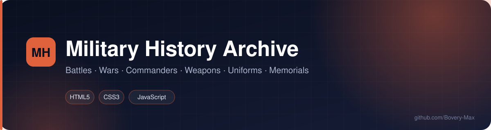
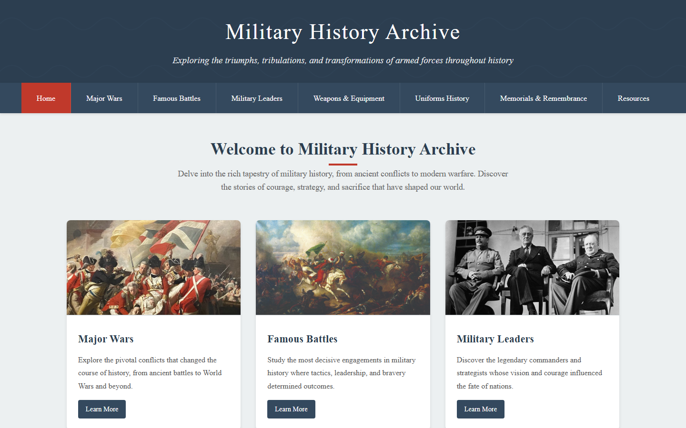

<div align="center">



<br/><br/>

<p><b>An educational static website on military history — battles, wars, commanders, weapons, uniforms and memorials.</b></p>


<br/><br/>

<a href="https://bovery-max.github.io/MilitaryHistoryWebsite/military-history-website/"></a>

<p>
<a href="#-pages">Pages</a> ·
<a href="#-running-locally">Running locally</a> ·
<a href="#-project-structure">Structure</a>
</p>

</div>



## 📋 Overview

A clean, readable reference for students and history enthusiasts, written in plain **HTML, CSS and JavaScript** — no frameworks, no build step, nothing to install.

## 📄 Pages

| File | Section | Covers |
|---|---|---|
| `index.html` | Home | Section overview cards |
| `wars.html` | Major Wars | Conflicts that reshaped the world |
| `battles.html` | Famous Battles | Marathon, Gaugamela, Cannae, Hastings, Waterloo, Gettysburg, Stalingrad, Midway, D-Day |
| `leaders.html` | Military Leaders | Sun Tzu, Alexander, Hannibal, Caesar, Mehmed II, Washington, Rommel, MacArthur |
| `weapons.html` | Weapons & Equipment | From bronze swords to modern arms |
| `uniforms.html` | Uniforms History | How military dress changed across centuries |
| `memorials.html` | Memorials & Remembrance | Monuments, cemeteries and the memory of war |
| `resources.html` | Resources | Further reading |

## 🚀 Running locally

```bash
git clone https://github.com/Bovery-Max/MilitaryHistoryWebsite.git
cd MilitaryHistoryWebsite/military-history-website
```

Open `index.html` in a browser, or serve the folder:

```bash
npx serve .
```

## 🗂️ Project structure

```
military-history-website/
  index.html
  wars.html  battles.html  leaders.html  weapons.html
  uniforms.html  memorials.html  resources.html
  styles.css          all styles, responsive breakpoints included
  js/main.js          navigation and interactivity
  Photos/             images and social icons
docs/                 README images
```

---

<div align="center">
<sub><i>"Those who cannot remember the past are condemned to repeat it."</i> — George Santayana</sub>
<br/><br/>
<sub>Built by <a href="https://github.com/Bovery-Max">Emir Sanal</a> · <a href="https://www.linkedin.com/in/emir-sanal-12432b322/">LinkedIn</a></sub>
</div>
